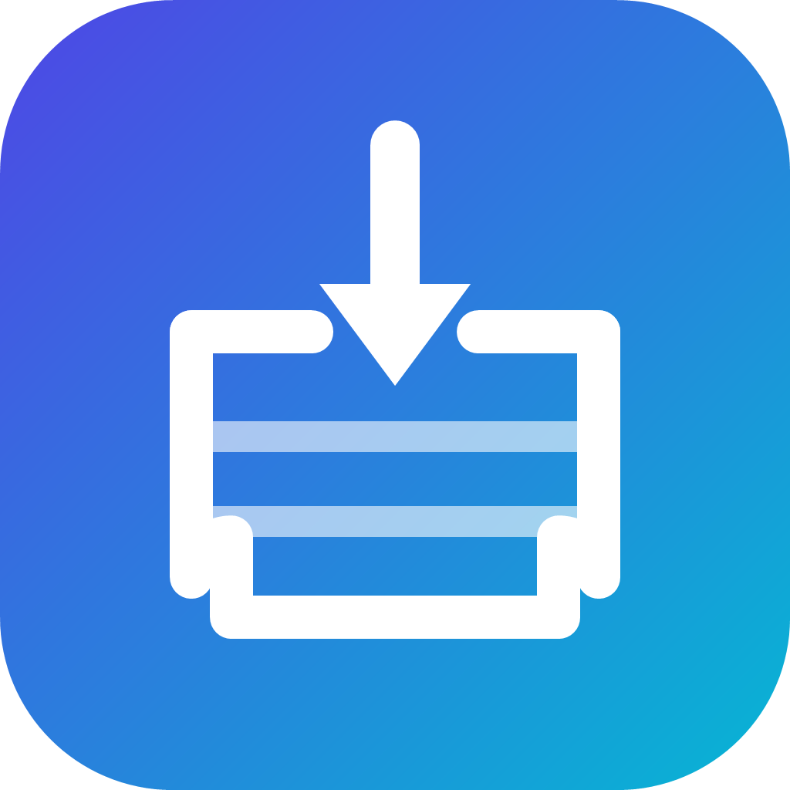

# StoreCrate

**A lightweight, modern Microsoft Store client for Windows.**

StoreCrate installs free Microsoft Store apps directly from Microsoft's own delivery
service — no Microsoft Store app, no App Installer, and no `winget` required.



[](https://github.com/naveenk0513/StoreCrate/actions/workflows/ci.yml)
[](https://github.com/naveenk0513/StoreCrate/releases)
[](LICENSE)

---

## Why StoreCrate?

Some Windows installs — LTSC, stripped-down images, kiosks, and freshly imaged
machines — do not include the Microsoft Store or the App Installer (`winget`)
package. Without them, installing a simple free app turns into a scavenger hunt
for `.appx` bundles and dependency frameworks.

StoreCrate closes that gap with a small, native-feeling client that:

- searches the public Microsoft Store catalog;
- resolves the exact package set your CPU architecture needs;
- downloads signed packages straight from Microsoft's CDN;
- installs them with the Windows package APIs already present in the OS.

It is an independent, open-source project. It is **not** affiliated with,
endorsed by, or supported by Microsoft.

## Features

- **Discover** — a curated home page built from live Store search results.
- **Search** — find apps by name, publisher, or category.
- **App details** — ratings, price, screenshots, version, size, architecture,
  package family name, and release date.
- **Smart package resolution** — picks the best main package and required
  frameworks (VCLibs, .NET Native, WinUI, Windows App Runtime, …) for x64, x86,
  or ARM64.
- **Download queue** — parallel downloads, live progress, cancel and retry.
- **Install / launch / uninstall** — uses `PackageManager` first, with an
  `Add-AppxPackage` fallback for difficult images.
- **Installed apps** — filter, launch, jump to the Store page, or remove apps.
- **Settings** — theme, market/locale, staging folder, concurrency, and update
  checks.
- **Automatic update check** — compares against GitHub Releases.
- **CLI** — the same pipeline, scriptable for troubleshooting.

## Requirements

| | |
|---|---|
| OS | Windows 10 version 2004 (build 19041) or newer, or Windows 11 |
| Architecture | x64 (self-contained build); x86/ARM64 when built from source |
| Runtime | None for the self-contained build. The framework-dependent build needs the [.NET 8 Desktop Runtime](https://dotnet.microsoft.com/download/dotnet/8.0) |

StoreCrate does not need the Microsoft Store, App Installer, `winget`, or a
Microsoft account.

## Install

1. Open the [Releases](https://github.com/naveenk0513/StoreCrate/releases) page.
2. Download one of:
   - `StoreCrate-<version>-win-x64.zip` — self-contained, recommended.
   - `StoreCrate-<version>-win-x64-framework-dependent.zip` — smaller, needs .NET 8.
3. Verify the download against `SHA256SUMS.txt` (optional but recommended).
4. Extract the archive anywhere and run `StoreCrate.exe`.

Windows may show a SmartScreen prompt because the binaries are not code-signed.
Choose **More info → Run anyway** if you trust the build.

## Usage

### Desktop app

- **Discover** shows featured and categorized free apps.
- **Search** queries the live Store catalog.
- Open an app and choose **Install**. Packages are downloaded to your staging
  folder and then registered with Windows.
- **Downloads** shows progress; **Installed** manages what is already on the PC.
- **Settings** lets you change market, locale, theme, staging folder, and the
  number of parallel downloads.

> Keep StoreCrate open while an install is running. Windows may show a
> confirmation prompt the first time a package is registered.

### Command line

The CLI is useful for verifying that a machine can reach Microsoft's endpoints
and install packages.

```text
StoreCrate.Cli search <query>            Search the Store catalog
StoreCrate.Cli info <productId>          Show product details
StoreCrate.Cli packages <productId>      Resolve packages for this device
StoreCrate.Cli download <productId>      Download packages without installing
StoreCrate.Cli install <productId>       Download and install a product
StoreCrate.Cli installed [--all]         List installed apps
StoreCrate.Cli uninstall <familyName>    Remove an installed app
StoreCrate.Cli update                    Check for a StoreCrate update
```

Example:

```powershell
dotnet run --project src/StoreCrate.Cli -- search spotify
dotnet run --project src/StoreCrate.Cli -- packages 9NCBCSZSJRSB
dotnet run --project src/StoreCrate.Cli -- install 9NCBCSZSJRSB
```

## Build from source

Prerequisites:

- [.NET 8 SDK](https://dotnet.microsoft.com/download/dotnet/8.0)
- Windows 10/11

```powershell
git clone https://github.com/naveenk0513/StoreCrate.git
cd StoreCrate
dotnet restore
dotnet build -c Release
dotnet test
dotnet run --project src/StoreCrate.App
```

Produce a self-contained single-file build:

```powershell
dotnet publish src/StoreCrate.App/StoreCrate.App.csproj `
  -c Release -r win-x64 --self-contained true `
  -p:PublishSingleFile=true `
  -p:EnableCompressionInSingleFile=true `
  -p:IncludeNativeLibrariesForSelfExtract=true `
  -o publish/win-x64
```

### Solution layout

```text
src/
  StoreCrate.Core/      Catalog + FE3 protocol, parsing, resolution, downloads
  StoreCrate.Windows/   PackageManager / PowerShell installation and app discovery
  StoreCrate.App/       Avalonia desktop UI (MVVM)
  StoreCrate.Cli/       Scriptable command-line client
tests/
  StoreCrate.Core.Tests/ Parser, resolver and model tests
```

## How it works

StoreCrate talks to the same public services the Store client uses:

1. **Display Catalog / Storefront search** supplies product metadata, pricing,
   ratings, images, and the Windows Update category ID (`WuCategoryId`).
2. **FE3 delivery (SyncUpdates + GetFileUrls)** lists the packages and their
   CDN URLs for that category. StoreCrate selects the best main package plus
   required framework dependencies for the current architecture.
3. **Download** streams the signed `.appx`/`.msix` files from Microsoft's HTTPS
   CDN into a staging folder.
4. **Install** registers the packages with `Windows.Management.Deployment.
   PackageManager`, falling back to `Add-AppxPackage` through PowerShell.

Packages are signed by Microsoft or the publisher and are verified by Windows
during registration. StoreCrate does not modify packages, patch licenses, or
circumvent DRM.

## Limitations

- Free apps only. StoreCrate intentionally does not handle paid purchases,
  account entitlements, or DRM.
- No Microsoft account sign-in.
- Some apps are not installable outside the Store because they require a
  license or a purchase.
- The catalog and delivery endpoints are undocumented and may change. When they
  do, StoreCrate may need an update.
- Builds are not code-signed, so SmartScreen may warn on first launch.

## Troubleshooting

| Symptom | What to try |
|---|---|
| `0x80073D05` or a deployment error | Close the app if it is running, then retry. Some frameworks require a reboot after first install. |
| Downloads stall | Check that `*.dl.delivery.mp.microsoft.com` and `store-images.s-microsoft.com` are reachable. |
| Search returns nothing | Verify the market and locale in **Settings** (for example `US` / `en-US`). |
| Install needs attention | Run StoreCrate as your normal user first. If it still fails, use the CLI to see the full error. |

Logs and settings live in `%LOCALAPPDATA%\StoreCrate`.

## Credits

StoreCrate stands on the shoulders of excellent open-source work:

- **[Avalonia UI](https://avaloniaui.net/)** — cross-platform .NET UI framework (MIT).
- **[FluentAvalonia](https://github.com/amwx/FluentAvalonia)** — Fluent Design controls and theming for Avalonia (MIT).
- **[CommunityToolkit.Mvvm](https://github.com/CommunityToolkit/dotnet)** — MVVM source generators and helpers (MIT).
- **[StoreLib](https://github.com/TitleOS/StoreLib)** by **TitleOS** — .NET library for Microsoft Store endpoints. StoreCrate uses it for the FE3 SOAP calls. StoreLib is licensed under the **Mozilla Public License 2.0**; see [THIRD-PARTY-NOTICES.md](THIRD-PARTY-NOTICES.md).
- **[Newtonsoft.Json](https://www.newtonsoft.com/json)** — JSON serialization used by StoreLib (MIT).
- **[Microsoft.Extensions.\*](https://github.com/dotnet/runtime)** — dependency injection, HTTP, and logging (MIT).
- **[xUnit.net](https://xunit.net/)** and **coverlet** — testing and coverage (Apache-2.0 / MIT).
- **Microsoft Store services** — catalog, imagery, and delivery endpoints. All trademarks and content belong to Microsoft Corporation. StoreCrate is an unofficial client.

The StoreCrate name, icon, and UI were created for this project. The icon is an
original design: a crate with a download arrow in an indigo-to-cyan gradient.

See [THIRD-PARTY-NOTICES.md](THIRD-PARTY-NOTICES.md) for license texts and
attribution details.

## Contributing

Issues and pull requests are welcome. Please read [CONTRIBUTING.md](CONTRIBUTING.md)
and keep changes focused. For security concerns, see [SECURITY.md](SECURITY.md).

## License

StoreCrate is released under the [MIT License](LICENSE).

Copyright (c) 2026 Naveen Kumar Yeluri and StoreCrate contributors.

Microsoft, Windows, Microsoft Store, and related marks are trademarks of
Microsoft Corporation. StoreCrate is not affiliated with Microsoft.
